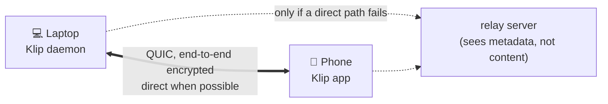

<div align="center">


### Copy on one of your devices, paste on another. End-to-end encrypted, no account, no cloud.

[](https://github.com/Tribal-Chief-001/Klip/actions/workflows/ci.yml)
[](https://github.com/Tribal-Chief-001/Klip/actions/workflows/android.yml)
[](LICENSE-MIT)
[](https://github.com/Tribal-Chief-001/Klip/releases)


</div>

> **Alpha software.** The Linux ↔ Android path works and has been tested (details in [Status](#status--what-is-actually-tested)), but it has had **no independent security review**, has only been tried on one real phone (the author's) plus an emulator, and macOS/Windows are only compile-checked. Read [Limits & honesty](#limits--honesty) before relying on it.

```text
╭── ●─● klip ───────────────────────────────────────────────────────────────╮
│                                                                          │
│ ● STATE    Active                                                        │
│ ● SYSTEM   Linux (X11)                                                   │
│ ● NETWORK  n0 public relays + discovery                                  │
│ ● RELAY    relay connected (https://aps1-1.relay.n0.iroh.link./)         │
│ ● DEVICE   VCUU-LBYY-ES2H                                                │
│                                                                          │
│ Linked devices                                                           │
│   └─ 🟢 Pixel 8  [75A6-H66R-SQDW]  connected                            │
│                                                                          │
│ Last sync  4s ago · "https://github.com/…" (38 B)                        │
╰──────────────────────────────────────────────────────────────────────────╯
```

## What it does

- Copy text on your laptop → it is on your phone's clipboard (and the other way round). Copied **images** wait until you choose to send them (see [The tray app](#the-tray-app)).
- Works **across networks** (phone on mobile data, laptop at home) — and on the same Wi-Fi without internet.
- **No account, no server of ours.** Devices find each other by cryptographic device ID.
- You decide what is linked: pairing needs a one-time QR/ticket **and** your approval on the other device.
- Honest feedback: when you send something, Klip tells you whether the other device really put it on its clipboard, or why not.
- If a copy cannot reach a device, Klip says so at that moment: a desktop notification on the laptop (once per outage), and the phone's notification shows how long the laptop has been gone.
- **Send files** between your linked devices, with `klip send-file photo.jpg` (any size up to 4 GiB by default, checked end to end with a BLAKE3 hash; nothing is ever overwritten). See [Sending files](#sending-files).
- **A tray icon (Linux):** a small menu to send the waiting image, pause, switch automatic images and open the terminal app; it starts at login (see below).
- **A full-screen app:** run `klip` on a terminal to see devices, pair, browse the history, send text, read the log and change settings without remembering commands.

## The tray app

Klip has a small tray icon with a menu on **Linux** (built for Linux Mint Cinnamon; any panel with StatusNotifier support should work), on the **macOS menu bar** and in the **Windows notification area**. Linux is the one that was seen working on a real desktop; the macOS and Windows trays were built and tested on CI runners only (see [Status](#status--what-is-actually-tested)). Everything else (devices, pairing, history, send, log, settings) is the [terminal app](#the-terminal-app). The tray is part of the `klip` binary (no Python, no GTK, nothing extra to install): on Linux it measured 8.9 MB resident (3.8 MB of its own) and no CPU while idle; the debug builds started on the CI runners measured about 14 MB on Windows and 50 MB on macOS (a release build and a real desktop were not measured).

```bash
klip tray install     # start it every time you log in
klip tray             # start it now (in the background)
```

- **The icon** is monochrome like the other panel icons (on Linux the desktop paints it in the panel's colour, on macOS the system tints a template image, on Windows it is drawn light or dark to match the taskbar theme); the shape is the state: a solid line between the two dots = connected, dots = waiting for a device, two bars = paused, faded = stopped or no devices; a dot in the corner = an image is waiting to be sent. Hover for the details.
- **Left or right click** opens the same menu: the state, send the last copied image, send images automatically, pause or resume, open the terminal app, quit the tray (start Klip, when it is stopped). **Middle click** sends the waiting image.
- **Images are manual**: a copied image is held for 10 minutes (the last one only) and is sent when you use the menu, middle-click the icon, or run `klip share` (bind it to a keyboard shortcut in your desktop's keyboard settings). Prefer the old behaviour? Tick *Send images automatically* in the menu, or run `klip images auto`. Text is always sent automatically.
- **Start at login** (`klip tray install`, undone by `klip tray uninstall`): Linux `~/.config/autostart/klip-tray.desktop`, macOS `~/Library/LaunchAgents/com.klip.tray.plist`, Windows the `KlipTray` value under `HKCU\Software\Microsoft\Windows\CurrentVersion\Run` (it runs `klip tray start`, so a console window may flash once at login). On Linux and macOS a login file that Klip did not make is never overwritten or removed; on Windows the value name `KlipTray` is Klip's own and is replaced or deleted without checking what it holds.
- **When something fails** (a refused send, an unreachable daemon) Linux shows one desktop notification; on macOS and Windows the problem is the first line of the menu for 30 seconds.
- Linux talks to the panel over D-Bus (StatusNotifierItem); macOS and Windows use `tao` and `tray-icon`. `klip tray status` says whether it is running. Quitting the tray never stops Klip itself.

## The terminal app

Run `klip` with no arguments on a terminal. Quitting (`q`) leaves Klip running in the background.

```text
●─● klip   1 Home  2 Devices  3 Pair  4 History  5 Send  6 Log  7 Settings                  ● ACTIVE
┌ Status ──────────────────────────────────────────────────────────────────────────────────────────┐
│● ACTIVE   relay connected (https://aps1-1.relay.n0.iroh.link./)                                  │
│this device  4RGS-5DPX-3MZG   Linux (X11)   RAM 15.8 MB                                           │
│128 clips synced · last 4s ago · "https://github.com/…" (38 B)                                    │
└──────────────────────────────────────────────────────────────────────────────────────────────────┘
┌ Devices (2) ─────────────────────────────────────────────────────────────────────────────────────┐
│  ● Vivo V2253              [XUXC-EASU-TQP7]  connected                                           │
│  ○ Pixel 8                 [E6Y4-MBFJ-TGTY]  offline · could not reach the device                │
└──────────────────────────────────────────────────────────────────────────────────────────────────┘
s start · x stop · 1-7 screens · p pause · h help · q quit
```

*Text snapshot from the test suite with sample data (not a screenshot of a real session).*

| Key | Does |
|---|---|
| `1`-`7` / `Tab` | switch screen (Home, Devices, Pair, History, Send, Log, Settings); `Alt+1-7` also inside a text field |
| `p` | pause or resume syncing |
| `h` | help for the current screen |
| `m` | mouse on/off (off lets you select text with the terminal) |
| `Ctrl+L` | redraw |
| `q` / `Ctrl+C` | quit |
| Devices | `↑↓` select · `u` unpair · `a` unpair all |
| Pair | `n` new code · `l` LAN addresses · `t` validity · `j` join with a ticket · `y`/`n` answer a request |
| History | `↑↓` select · `/` search · `Enter` copy back to this computer · `s` send again · `v` show a secret · `c` clear · `Home`/`End` first/last |
| Send | `Enter` start typing (until then the number keys still switch screens) · `Ctrl+S`/`F5` send · `Ctrl+O` load a file · `Ctrl+U` clear · `Esc` stop typing |
| Log | `f` follow · `/` search · `PgUp`/`PgDn` scroll · `End` newest |
| Settings | `↑↓` select · `Enter` edit/toggle · `s` save · `u` discard · `r` restart Klip |

Keys are lowercase letters only: a capital letter (Shift or Caps Lock) does the same as the small one, outside text fields. Colours: `NO_COLOR=1` switches to bold/reverse, `KLIP_THEME=light` for light terminals; meaning is never colour-only.

The Pair screen shows the QR code beside the ticket. If the window is too small for it, Klip asks the terminal to grow (and gives the old size back when you leave the screen); terminals that do not allow that keep their size and the screen says how big it needs to be.

*Clips shown on screen are sanitized: escape sequences and text-direction tricks appear as visible marks (`␛`, `⟦U+202E⟧`). Secrets are hidden until you press `v`. The pairing ticket is a secret: it is shown only on the Pair screen and the window closes when you leave it. Terminal scrollback and screen recorders can still capture what is on screen.*

## Status — what is actually tested

| Part | State | Evidence |
|---|---|---|
| Core engine (pairing, sync, conflict resolution) | ✅ working | 360 automated Rust tests (including the tray) in the whole workspace (real network endpoints, two full daemons, pairing, unpair, pause, bad input, random-input decoding) run in CI; a two-daemon crash/restart chaos script was run by hand (not in CI) |
| **Terminal app (TUI)** (`klip` with no arguments) | 🟡 Linux, tested in a pseudo-terminal and against two real daemons | The terminal app's own tests: screens as text snapshots at 60×16 and 100×30, 56,000 random key/mouse/paste/resize/reply events (no panic), the real binary in a pseudo-terminal (terminal restored after quit, SIGTERM, SIGHUP and a panic; `TERM=dumb`; resize), and a run with two real daemons (pair → send → copy back → pause → unpair all). Also run read-only against a real v0.3.6 daemon. **Not verified:** how it looks in kitty, gnome-terminal, alacritty, tmux or over SSH; macOS; Windows (not built: the CLI cannot reach the daemon there). |
| **Linux (X11)** daemon + CLI | ✅ tested on a real machine | pairing, clipboard in both directions through the real X11 clipboard, restart, unpair |
| **Tray app** (`klip tray`, Linux) | 🟡 tested without a real panel | Unit tests of every state and menu, and end-to-end tests of the real tray on a private D-Bus session against an isolated daemon (click through the menu, check what the daemon did, quit, a second tray refused). See the release notes for what was and was not seen on the author's real panel. |
| **Android app** | 🟡 emulator (Android 14) + one real phone (Vivo, reported by the author) | Emulator: pairing through the n0 relay, sync both ways, background clipboard write, restart/reconnect, reboot, notification, setup screens. Real phone (author's report): laptop → phone arrives by itself; phone → laptop works with Share → Klip, the notification button or the app's Send button. **Not verified:** background persistence over hours, reboot, camera QR scan, the tile, battery cost on a real phone |
| Linux Wayland | 🟡 partial | works through XWayland apps only; GNOME needs more work |
| macOS | 🟡 built and tested on a CI runner, never on a real Mac | On `macos-latest`: the whole workspace compiles, the tray's unit tests, the daemon end-to-end tests (31, with a real memory figure), the CLI against a real daemon (7), the login entry, and a 10-second start of the real tray without a crash. NOT seen: the menu bar icon and menu, real clicks, the real clipboard in a desktop session. |
| Windows | 🟡 built and tested on a CI runner, never on a real PC | The control channel is a named pipe (`\\.\pipe\klip-<hash>`) that only the user who runs the daemon can open (a DACL naming that user's SID). On `windows-latest`: it compiles, a daemon is started, answers on the pipe, takes a text and shows it in the history; the CLI against a real daemon (7), the core and daemon unit tests, the registry login entry, and a 10-second start of the real tray without a crash. NOT seen: the tray icon and menu, real clicks, the real clipboard, another user being refused by the pipe. |
| iOS | ⚪ not started | Apple does not allow background clipboard access |

## How it works



- Every device has an Ed25519 key; its public half is the device ID (`klip status` shows a short fingerprint like `VCUU-LBYY-ES2H`).
- Connections use QUIC/TLS 1.3 via [iroh](https://iroh.computer), which authenticates **both** sides by device key and tries to connect directly (hole punching); relays are the fallback.
- Only devices you paired are accepted. A clip is accepted only if the sender is the device that claims to have copied it.
- Conflicts: the newest copy wins (hybrid logical clock); clocks too far in the future are rejected.

## Install

### Linux (from source, ~5 min)

You need Rust 1.91 or newer: <https://rustup.rs>

```bash
git clone https://github.com/Tribal-Chief-001/Klip.git
cd Klip
cargo build --release -p klip-cli
install -Dm755 target/release/klip ~/.local/bin/klip     # make sure ~/.local/bin is in your PATH
klip start
klip status
klip            # opens the full-screen app (see below)
```

Pre-built binaries and the Android APK are attached to the [Releases](https://github.com/Tribal-Chief-001/Klip/releases) page (pre-releases while the project is alpha).

### Android

1. Download **`Klip-Android.apk`** from the latest release (about 10-11 MB; it is for 64-bit phones, i.e. nearly every phone since 2017). Only if your phone is very old and 32-bit, take `Klip-Android-armv7.apk` instead. Open it and allow “install unknown apps” for your browser/file manager.
2. Open **Klip** and tap **Setup** (top right). It lists every permission and phone setting Klip needs to keep running with the screen off and after a restart, explains what each one does and cannot see, and has the steps for your phone brand (Vivo, Xiaomi, Oppo/Realme/OnePlus, Samsung, Huawei/Honor; others need nothing extra). It marks the ones Android lets it check as done.
3. **Privacy** (top right) says in plain words where clips go and what Klip does and never does.

Needs Android 8.0 or newer. Updating from an earlier alpha keeps your pairings (same signing key).

**Size.** The APK was 39 MB (three CPU types in one file, no code shrinking). It is now one APK per CPU type with the Kotlin code shrunk by R8 and without AppCompat/Material: **10.7 MB for arm64** (measured on a local release build). 95% of that is the Rust engine (QUIC, TLS, relay client), about 10 MB; a 2-3 MB app is not possible with this stack. The Android library is built with `panic = "abort"` (saves 2.2 MB); a crash restarts the background service by itself.

## Link your devices (once)

**On the computer**

```bash
klip pair
```

A QR code and a text ticket appear. **Keep this window open.**

**On the phone**

1. Open Klip → **Scan a QR code to link a device** → point it at the QR.
   (No camera? **Paste a ticket instead**.)
2. Back on the computer a question appears: *“<phone> wants to pair [fingerprint] — Approve?”* → type `y`.

Done. Test it: copy something on one device, paste on the other.

The ticket works **once** and expires after 2 minutes. Pairing a second phone? Run `klip pair` again.
Phone is the one showing the code? In the app tap **Show a QR code for another device**, then on the computer run `klip pair <ticket>`.

## Everyday use

| I want to… | Do this |
|---|---|
| Copy text on the computer, paste on the phone | Just copy. It arrives on the phone's clipboard by itself. |
| Copy an image on the computer, paste on the phone | Copy it, then use *Send the last copied image* in the tray menu (or middle-click the tray icon, or run `klip share`). Images wait for you on purpose. |
| Send a file from the phone | In any app (Files, Gallery, ...): Share → **Send as a file with Klip**. It goes to every linked device that is online; a notification shows the progress and has a Cancel button. |
| Get a file on the phone | Send it from the computer (`klip send-file`). It arrives in **Downloads/Klip** and a notification says so (never with the file's name). |
| Copy on the phone, paste on the computer | Share → Klip, or tile / notification button (Android can't notice a copy by itself — see [why](#phone--computer-android-limits)). |
| A quick menu in the panel | the tray icon (`klip tray install` to start it at login) |
| Do everything in one terminal screen | `klip` (the full-screen app: devices, pair, history, send, log, settings) |
| See what happened | `klip status`, `klip history` |
| Send text without copying | `klip send "text"` |
| Stop syncing for a while | `klip pause 600` … `klip resume` |
| Remove a device | `klip unpair "Pixel 8"` (name or start of its fingerprint) |

### Sending files

The phone takes part too: it receives into `Downloads/Klip` (switch and size limit under **Privacy → Receive files**, default limit 2 GiB because a received file exists twice for a moment) and sends from the Share sheet ("Send as a file with Klip", one file or several).

```bash
klip send-file report.pdf photos/*.jpg          # to every linked device that is online
klip send-file movie.mkv --to "Pixel 8"         # to one device
klip send-file big.iso --no-wait                # start it and return; see it with `klip transfers`
klip transfers                                   # running and recent transfers
klip transfers --cancel 3fa9                     # stop one (the start of its id)
```

- Files arrive in `~/Downloads/Klip` on a computer (set `receive_dir` to change it). A name that is taken gets ` (2)`, ` (3)`: an existing file is never replaced. Odd or dangerous names (`../`, `CON`, trailing dots) are cleaned.
- Each file goes over its own encrypted stream, so clips keep syncing while a big file moves. The receiver writes a hidden `.klip-….part` file, checks the BLAKE3 hash, and only then gives it its name; a failed or cancelled transfer leaves nothing behind.
- Both devices must be online together (same rule as clips). **There is no resume in this version:** an interrupted transfer starts again from zero.
- The other device can refuse: `"accept_files": false`, a file over its `max_file_bytes`, not enough free disk space (it keeps 512 MiB free), or too many transfers at once. You are told why.
- On Linux a desktop notice says "Received 1 file from <device> (<size>)", never the file name.

### Phone → computer (Android limits)

**Why isn't it automatic?** Android 10+ only lets the app *in front* read the clipboard, and — verified on Android 14 — it does not even tell Klip that something was copied while another app is in front. So Klip cannot notice a copy by itself. (Computer → phone is instant because *writing* the clipboard is allowed.) Ways around it, easiest first, none needs special permissions:

1. **Share → Klip** — in any app (browser, chat…) use the normal Share button and pick **Klip**. Best for links.
2. **Select text → ⋮ → “Send to Klip”** in the text-selection menu.
3. **Quick Settings tile** “Klip” (swipe down, edit tiles, add Klip): copy, then tap the tile.
4. **“Send clipboard”** button in Klip's notification.

Both 1 and 2 were tested to reach the computer without opening Klip.

**Automatic sending (optional helper).** Android only lets the app on screen read the clipboard, so by default a copy made in another app is not noticed. The old trick of watching the system log (what KDE Connect used) is closed on **Android 13 and newer**: the system denies log access to background apps (AOSP `LogcatManagerService`), so Klip no longer uses it. What works instead is a small helper process that runs with the Android *shell* identity, which may read the clipboard in the background (the way scrcpy does it):

- **From a computer, once:** *Setup → Automatic copy from this phone* shows one `adb shell …` command (with a secret token) to run with USB debugging on; it starts the helper and returns. It stops when the phone restarts.
- **Rooted phones:** *Start with root* makes Klip start the helper itself (through `su`) whenever its service starts, including after a restart; the helper drops to the shell user.

The helper hands each copy to Klip over a loopback connection that both sides authenticate with the token (SELinux does not let the shell user use an app's Unix socket). Copies that apps mark as sensitive (password managers) are not sent automatically. **Cost:** a separate Java process, about **61 MB PSS** measured on an Android 14 emulator. **Verified (emulator):** with Klip in the background, a copy in another app reached a desktop daemon, started as the shell user and started as root (after dropping to shell); the in-app command, the live status and *Stop* work. **Not verified:** a real phone, Magisk's `su` prompt and the `su` call itself, Android 15/16, OEM restrictions on `app_process`. **Dead ends checked (2026-10-13, Android 14 emulator):** `READ_CLIPBOARD_IN_BACKGROUND` would remove the need for a helper, but it is held through the role `SYSTEM_TEXT_INTELLIGENCE` (`systemOnly`), and `pm grant` refuses it ("managed by role"). The helper's memory is the Android runtime itself: its private pages are mostly the boot images (`boot-framework.art` 13 MB, `boot-framework-adservices.art` 6 MB, `boot.art` 3 MB); `-Xmx`, `-Xusejit:false` and `-Xnorelocate` changed nothing. Only a native (non-Java) helper could be much smaller; that needs raw Binder calls and ClipData parcel parsing that differ between Android versions, which I cannot test on real phones yet.

Writing *to* the phone's clipboard from the background works without any special permission (tested on Android 14). If some phone brand blocks it, Klip shows a “tap to copy” notification instead of dropping the clip.

### Banking / UPI apps

Out of the box Klip uses **no Accessibility service** (the earlier prototype did, which is what made UPI apps complain), **no “display over other apps”** and **no log access**. The optional clipboard helper is a separate process you start yourself. I could not test real UPI apps (no Play Store on my test device), so this is unverified. If a payment app complains: stop the helper (Setup → Automatic copy → Stop) and tell me which app and message it shows; I will build a lean variant.

## Start automatically

| Platform | Status |
|---|---|
| **Linux** | `klip install-service` + `systemctl --user enable --now klip.service` starts it at every login (systemd user unit). Verified: after `kill -9` systemd restarts the daemon in about 3 s and the phone reconnects. A full reboot of the author's machine has not been exercised. |
| **Android** | A foreground service (type *specialUse*, so Android 15's 6-hour limit and boot restrictions for *dataSync* do not apply) restarts after a reboot and reconnects by itself. Verified on an Android 14 emulator: after killing the app process Android restarted the service within 5 s and the laptop saw the device again; after a full emulator reboot, without opening the app, the service came back and the laptop could deliver a clip to it. After a reboot Android only delivers the boot event after the first unlock. **Not verified:** swiping the app out of recents, Android 15/16, and real phones' battery managers (Xiaomi, Oppo, Vivo, Samsung… may kill background apps: allow background activity / auto-start for Klip in the phone's settings). If you force-stop Klip, open it once to start it again (Android's rule). **Stop and restart rules (Android 14 emulator):** the *Stop* button in Android's active-apps list removes the whole app; a watchdog job (every ~15 min, switchable in Privacy) then starts Klip again, but only if Unrestricted battery use is allowed for it (without it Android refuses: tested both ways). The service also starts by itself after an app update and after a restart. A *Force stop* in App info cannot be undone by any app. If notifications are switched off and on again, the notification comes back within seconds (this was a bug before 0.3.4). |
| **macOS** | `klip install-service` writes a launchd agent for the daemon — never run, untested. `klip tray install` writes the tray's own launch agent (checked by a CI test that reads the file, not run by a real login). |
| **Windows** | `klip install-service` writes a Task Scheduler script — never run. The CLI, the terminal app and the tray do control the daemon now (named pipe). `klip tray install` writes the Run-key value (checked on a CI runner). |

```bash
klip install-service
systemctl --user enable --now klip.service
systemctl --user status klip.service
```

## Settings

`~/.config/klip/config.json` (all keys optional; a typo is an error, never silently ignored):

```json
{
  "device_name": "ThinkPad",
  "relay": "n0",
  "lan_discovery": true,
  "max_clip_bytes": 33554432,
  "max_history_items": 50,
  "history_ttl_hours": 24,
  "poll_interval_ms": 100,
  "auto_send_images": false,
  "accept_files": true,
  "receive_dir": "/home/you/Downloads/Klip",
  "max_file_bytes": 4294967296
}
```

- `"relay": "n0"` (default) uses n0's public relay and discovery servers so devices on different networks can find each other. `"relay": "lan"` uses **no third-party servers at all**, but then both devices must be on the same network.
- `history_ttl_hours` (default **24**): clips older than this are forgotten from the history automatically (also from `klip history` and the app). `0` keeps them until the item count and size limits push them out. The history lives in memory only, so a restart clears it anyway.
- `auto_send_images` (default **false**): `false` = a copied image waits until you send it (tray, `klip share`); `true` = every copied image is sent at once. The tray and `klip images auto|manual` change it while Klip runs and save it here. Text is not affected.
- `accept_files` (default **true**): receive files from linked devices. `receive_dir` must be an absolute path (default: your Downloads folder, subfolder `Klip`). `max_file_bytes` (default 4 GiB) is the biggest file this device accepts.
- `lan_discovery` announces the device ID on your local network (mDNS) so same-Wi-Fi devices connect without internet.
- Environment: `KLIP_CONFIG_DIR` (separate instance), `KLIP_CLIPBOARD=memory` (don't touch the OS clipboard — servers/demos).

## Command reference

| Command | What it does |
|---|---|
| `klip` | open the full-screen terminal app (on a terminal; in a script it prints this help) |
| `klip start [--foreground]` | start the background service |
| `klip stop` | stop it |
| `klip status` | devices, connection, relay state, last sync |
| `klip pair [--lan] [--ttl 120]` | show QR + ticket and wait for a device |
| `klip pair <ticket>` | join the device that showed a ticket |
| `klip unpair <name\|fingerprint>` | forget a device |
| `klip unpair --all [-y]` | forget every device (asks first unless `-y`) |
| `klip pause [seconds]` / `klip resume` | pause or resume syncing |
| `klip history [-l N]` | recent clips (secrets are masked; forgotten after 24 hours by default) |
| `klip history clear` | forget all clips kept on this computer |
| `klip send "<text>"` | send text now, with per-device result (`klip send -` reads standard input) |
| `klip share` | send the image you copied last (held for 10 minutes), with a per-device result |
| `klip send-file FILE... [--to NAME] [--no-wait]` | send files to your linked devices; exit code 1 if any did not arrive |
| `klip transfers [--cancel ID]` | running and recent file transfers; stop one |
| `klip images [auto\|manual]` | show or choose whether copied images are sent at once or wait for `klip share` |
| `klip tray [start\|run\|install\|uninstall\|status]` | the tray icon (Linux): start it, or make it start at login |
| `klip install-service` | create the auto-start unit for your OS |

## Limits & honesty

**Security — what you can and cannot expect**

- Clip contents are end-to-end encrypted between your devices. Relays and network observers see **metadata** (that two device IDs talk, when, and how much), never contents.
- With `"relay": "n0"`, your device ID and its network addresses are published to n0's discovery service so peers can find you. Use `"relay": "lan"` if that matters to you.
- Keys are classical (X25519 + Ed25519). **Post-quantum key exchange is not enabled yet** (planned; the library supports it as an option).
- Not independently audited. Do not rely on it for anything where a bug would be dangerous.
- The “secret” detector (patterns + entropy) is a heuristic: it hides previews in history and asks Android to hide keyboard previews. It does **not** stop secrets from syncing and will miss some.
- The keystore (`~/.config/klip/keystore.json`) holds the device key in a private (0600) file; it is not encrypted with a password or the OS keyring yet.
- Anyone who can run commands as you can read your clipboard history through the local control socket. A stolen or lost device stays trusted until you `klip unpair` it from another one.

**Behaviour**

- **Both devices must be online at the same time.** There is no mailbox or push service: a clip copied while the other device is off is not delivered later. (A deliberate choice: no server of ours.)
- **Images (v0.5.0, manual since v0.6.0):** a PNG/WebP copied on the computer waits until you send it (tray menu, middle click, `klip share`, or switch on automatic sending); then it lands on the phone's clipboard and pastes into other apps. From the phone, **Share → Klip** an image, or copy an image and tap the tile or the notification button; anything that is not PNG/WebP (JPEG, HEIC...) is converted to PNG first, which also removes EXIF/GPS data, applies the photo's rotation, and scales it down if it would be over the limit. Never automatic from the phone (Android does not let Klip read the clipboard in the background). Limits: 12 MB on the phone (32 MiB on a computer), at most 36 megapixels (about 8K); a bigger image, a file that is not really a PNG/WebP, or a "decompression bomb" is refused before it is decoded, and the sender is told. Received images are kept as files in the app's cache; old ones are removed when the next image arrives or when Klip restarts (the newest 4 are kept, none older than an hour at that moment), so the last received image can stay there longer. Animated GIFs and several images at once are not supported. Tested on the author's phone: a screenshot copied on the Linux computer arrives on the phone and pastes into WhatsApp.
- Clips are limited to 32 MiB by default (12 MB on the phone). **Android is stricter for text: a text clip over about 0.9 MB cannot be put on the phone's clipboard** (Android passes it through one Binder transaction of about 1 MB). The sender is told "the other device could not write its clipboard"; nothing crashes (it did before 0.3.6: see the [release notes](https://github.com/Tribal-Chief-001/Klip/releases/tag/v0.3.6-alpha)).
- **What is preserved.** Text is sent as UTF-8 bytes and written back unchanged: tabs, indentation, trailing spaces, blank lines, CRLF and bare CR, emoji, CJK, right-to-left text, combining and zero-width characters, a BOM, links with query strings, and very long lines. Tested between two desktop daemons with a 400 KB+ source-like file (byte for byte), and on an Android 14 emulator with 57 KB, 249 KB and 504 KB code files (accepted; a 504 KB clip made the round trip phone → laptop with the same size and the same start; no full byte-for-byte comparison on Android).
- **What is not.** Only *plain text* is synced between phone and computer: rich formatting (bold, colours, syntax highlighting copied from a web page or an editor), HTML tables are not carried over a phone (images are, see above; files go with `klip send-file`, computer to computer only for now). A copy that an app marks as sensitive (password managers) is not sent automatically by the optional helper.
- Large text from the terminal: `cat main.rs | klip send -` is limited by the daemon's clip limit (32 MiB by default) plus 64 KiB; text over the limit is refused before it is sent, with the limit in the message. (The argument form is limited to about 128 KB by Linux.)
- Idle cost (measured on a release build, one linked device, Linux/X11): about **14 MB** resident memory, ~**3 wakeups per second**, no measurable CPU. Capture is event-driven (the X server tells Klip when the clipboard changes); the remaining wakeups are iroh's connection upkeep. Without X11 events (headless / `KLIP_CLIPBOARD=memory`) Klip falls back to polling and uses more.
- Release binary: 8.2 MB (stripped, size-optimised; 7.8 MB before the terminal app). The terminal app idles at about 8 MB resident and 0.125 % of one core (measured over 120 s on a release build).
- Debug-signed Android builds change signature between CI runs; installing a newer build over an older one may require uninstalling first (re-pair afterwards). A stable release key is planned.

## Troubleshooting

| Symptom | Try |
|---|---|
| `klip status` says *relay unreachable* | no internet / blocked UDP & HTTPS to n0; use `"relay": "lan"` on the same Wi-Fi |
| Devices linked but **not connected** | wait ~10 s (it retries); check both have internet or the same network; `klip status` shows the last error |
| “could not reach any linked device” on `klip send` | other device is off/asleep/offline — see *both devices online* above |
| “the other device could not write its clipboard” | the phone/desktop clipboard was unavailable; try again |
| Pairing: “invalid or expired pairing code” | tickets work once and expire; run `klip pair` again |
| `klip start` says it did not come up | read `~/.config/klip/daemon.log` |
| Nothing syncs on Wayland | Klip currently uses the X11 clipboard (XWayland); GNOME/Wayland needs an extension that is not finished |
| `klip` prints help instead of opening the app | it only opens on a terminal with a real `TERM` (not `dumb`) and no arguments; use `klip status` etc. in scripts |
| Banking/UPI app complains about Klip | see [Banking / UPI apps](#banking--upi-apps); also remove the old prototype's Accessibility service if it is still enabled |

## Build & test from source

```bash
cargo test --workspace                      # 360 tests
cargo clippy --workspace --all-targets -- -D warnings
android/build-core.sh arm64-v8a             # Rust engine + Kotlin bindings (needs cargo-ndk, NDK r28+)
cd android && ./gradlew assembleDebug
```

Layout: `klip-proto` (clip/clock/IPC types) · `klip-crypto` (identity, keystore) · `klip-net` (QUIC node, pairing) · `klip-core` (engine) · `klip-platform` (clipboard drivers) · `klip-daemon` + `klip-cli` (desktop) · `klip-android` (FFI) · `android/` (app).

## More documents

- [`docs/AUDIT_AND_ROADMAP.md`](docs/AUDIT_AND_ROADMAP.md) — frank audit of the earlier code and the roadmap
- [`docs/RESEARCH_2026.md`](docs/RESEARCH_2026.md) — sourced research, decisions and measurements
- [`docs/ARCHITECTURE_AND_RESEARCH.md`](docs/ARCHITECTURE_AND_RESEARCH.md) — the original (unverified, aspirational) design brief

## License

Dual-licensed under [MIT](LICENSE-MIT) or [Apache-2.0](LICENSE-APACHE), at your option.
