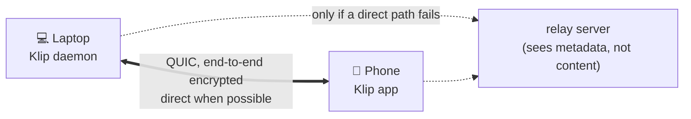

<div align="center">

# 📎 Klip

### Copy on one of your devices, paste on another. End-to-end encrypted, no account, no cloud.

[](https://github.com/Tribal-Chief-001/Klip/actions/workflows/ci.yml)
[](https://github.com/Tribal-Chief-001/Klip/actions/workflows/android.yml)
[](LICENSE-MIT)


</div>

> **Alpha software.** The Linux ↔ Android path works and has been tested (details in [Status](#status--what-is-actually-tested)), but it has had **no independent security review**, has not yet run on a physical phone, and macOS/Windows are only compile-checked. Read [Limits & honesty](#limits--honesty) before relying on it.

```text
╭── 📎 Klip ───────────────────────────────────────────────────────────────╮
│                                                                          │
│ ● STATE    Active                                                        │
│ ● SYSTEM   Linux (X11)                                                   │
│ ● NETWORK  n0 public relays + discovery                                  │
│ ● RELAY    relay connected (https://aps1-1.relay.n0.iroh.link./)         │
│ ● DEVICE   VCUU-LBYY-ES2H                                                │
│                                                                          │
│ Linked devices                                                           │
│   └─ 🟢 Pixel 8  [75A6-H66R-SQDW]  connected                            │
│                                                                          │
│ Last sync  4s ago · "https://github.com/…" (38 B)                        │
╰──────────────────────────────────────────────────────────────────────────╯
```

## What it does

- Copy text on your laptop → it is on your phone's clipboard (and the other way round).
- Works **across networks** (phone on mobile data, laptop at home) — and on the same Wi-Fi without internet.
- **No account, no server of ours.** Devices find each other by cryptographic device ID.
- You decide what is linked: pairing needs a one-time QR/ticket **and** your approval on the other device.
- Honest feedback: when you send something, Klip tells you whether the other device really put it on its clipboard, or why not.

## Status — what is actually tested

| Part | State | Evidence |
|---|---|---|
| Core engine (pairing, sync, conflict resolution) | ✅ working | 51 automated tests (real network endpoints, two full daemons, pairing, unpair, pause, bad input) run in CI |
| **Linux (X11)** daemon + CLI | ✅ tested on a real machine | pairing, clipboard in both directions through the real X11 clipboard, restart, unpair |
| **Android app** | 🟡 tested on an emulator (Android 14) only | pairing through the n0 relay, sync both ways, background clipboard write, restart/reconnect. **Not yet tried on a physical phone**, not the camera QR scan, not the tile |
| Linux Wayland | 🟡 partial | works through XWayland apps only; GNOME needs more work |
| macOS, Windows | 🔴 compile-checked in CI only | never run; the Windows CLI cannot control the daemon yet |
| iOS | ⚪ not started | Apple does not allow background clipboard access |

## How it works



- Every device has an Ed25519 key; its public half is the device ID (`klip status` shows a short fingerprint like `VCUU-LBYY-ES2H`).
- Connections use QUIC/TLS 1.3 via [iroh](https://iroh.computer), which authenticates **both** sides by device key and tries to connect directly (hole punching); relays are the fallback.
- Only devices you paired are accepted. A clip is accepted only if the sender is the device that claims to have copied it.
- Conflicts: the newest copy wins (hybrid logical clock); clocks too far in the future are rejected.

## Install

### Linux (from source, ~5 min)

You need Rust 1.91 or newer: <https://rustup.rs>

```bash
git clone https://github.com/Tribal-Chief-001/Klip.git
cd Klip
cargo build --release -p klip-cli
install -Dm755 target/release/klip ~/.local/bin/klip     # make sure ~/.local/bin is in your PATH
klip start
klip status
```

Pre-built binaries and the Android APK will be attached to the [Releases](https://github.com/Tribal-Chief-001/Klip/releases) page once a tested alpha is tagged. Until then the latest APK is the **artifact of the newest green run** of the [Android workflow](https://github.com/Tribal-Chief-001/Klip/actions/workflows/android.yml).

### Android

1. Download the APK (see above), open it, allow “install unknown apps” for your browser/file manager.
2. Open **Klip**. Allow notifications (Android 13+) — the small notification shows Klip is running.
3. Optional but recommended: tap **Allow background activity (battery)**.

Needs Android 8.0 or newer.

## Link your devices (once)

**On the computer**

```bash
klip pair
```

A QR code and a text ticket appear. **Keep this window open.**

**On the phone**

1. Open Klip → **Scan a QR code to link a device** → point it at the QR.
   (No camera? **Paste a ticket instead**.)
2. Back on the computer a question appears: *“<phone> wants to pair [fingerprint] — Approve?”* → type `y`.

Done. Test it: copy something on one device, paste on the other.

The ticket works **once** and expires after 2 minutes. Pairing a second phone? Run `klip pair` again.
Phone is the one showing the code? In the app tap **Show a QR code for another device**, then on the computer run `klip pair <ticket>`.

## Everyday use

| I want to… | Do this |
|---|---|
| Copy on the computer, paste on the phone | Just copy. It arrives on the phone's clipboard by itself. |
| Copy on the phone, paste on the computer | See [Phone → computer](#phone--computer-android-limits) below. |
| See what happened | `klip status`, `klip history` |
| Send text without copying | `klip send "text"` |
| Stop syncing for a while | `klip pause 600` … `klip resume` |
| Remove a device | `klip unpair "Pixel 8"` (name or start of its fingerprint) |

### Phone → computer (Android limits)

Android only lets the app **in front** read the clipboard, so a copy made in another app can't be noticed in the background. This is an Android rule, not a Klip bug. Options, easiest first:

1. **Quick Settings tile** “Klip” (swipe down, edit tiles, add Klip): tap it after copying.
2. **“Send clipboard”** button inside Klip's notification.
3. **“Send to Klip”** in the text-selection menu of any app.
4. **Automatic mode** (what KDE Connect does): needs a computer once — details in the app under *Automatic copy from this phone (setup)*:
   ```bash
   adb shell pm grant com.klip.app android.permission.READ_LOGS
   ```
   plus allowing “Display over other apps” for Klip. Klip then reads only its own “clipboard access denied” line from the system log. Undo with `adb shell pm revoke com.klip.app android.permission.READ_LOGS`.

Writing *to* the phone's clipboard from the background works without any special permission (tested on Android 14: the clip was there after Klip was in the background). If some phone brand blocks it, Klip shows a “tap to copy” notification instead of dropping the clip.

## Start automatically

```bash
klip install-service
systemctl --user enable --now klip.service
systemctl --user status klip.service
```

On Android the background service is set up to restart after a reboot (this part is not tested yet).

## Settings

`~/.config/klip/config.json` (all keys optional; a typo is an error, never silently ignored):

```json
{
  "device_name": "ThinkPad",
  "relay": "n0",
  "lan_discovery": true,
  "max_clip_bytes": 33554432,
  "max_history_items": 50,
  "poll_interval_ms": 100
}
```

- `"relay": "n0"` (default) uses n0's public relay and discovery servers so devices on different networks can find each other. `"relay": "lan"` uses **no third-party servers at all**, but then both devices must be on the same network.
- `lan_discovery` announces the device ID on your local network (mDNS) so same-Wi-Fi devices connect without internet.
- Environment: `KLIP_CONFIG_DIR` (separate instance), `KLIP_CLIPBOARD=memory` (don't touch the OS clipboard — servers/demos).

## Command reference

| Command | What it does |
|---|---|
| `klip start [--foreground]` | start the background service |
| `klip stop` | stop it |
| `klip status` | devices, connection, relay state, last sync |
| `klip pair [--lan] [--ttl 120]` | show QR + ticket and wait for a device |
| `klip pair <ticket>` | join the device that showed a ticket |
| `klip unpair <name\|fingerprint>` | forget a device |
| `klip pause [seconds]` / `klip resume` | pause or resume syncing |
| `klip history [-l N]` | recent clips (secrets are masked) |
| `klip send "<text>"` | send text now, with per-device result |
| `klip install-service` | create the auto-start unit for your OS |

## Limits & honesty

**Security — what you can and cannot expect**

- Clip contents are end-to-end encrypted between your devices. Relays and network observers see **metadata** (that two device IDs talk, when, and how much), never contents.
- With `"relay": "n0"`, your device ID and its network addresses are published to n0's discovery service so peers can find you. Use `"relay": "lan"` if that matters to you.
- Keys are classical (X25519 + Ed25519). **Post-quantum key exchange is not enabled yet** (planned; the library supports it as an option).
- Not independently audited. Do not rely on it for anything where a bug would be dangerous.
- The “secret” detector (patterns + entropy) is a heuristic: it hides previews in history and asks Android to hide keyboard previews. It does **not** stop secrets from syncing and will miss some.
- The keystore (`~/.config/klip/keystore.json`) holds the device key in a private (0600) file; it is not encrypted with a password or the OS keyring yet.
- Anyone who can run commands as you can read your clipboard history through the local control socket. A stolen or lost device stays trusted until you `klip unpair` it from another one.

**Behaviour**

- **Both devices must be online at the same time.** There is no mailbox or push service: a clip copied while the other device is off is not delivered later. (A deliberate choice: no server of ours.)
- Text only on Android for now. The desktop engine understands images, but the phone app does not yet.
- Clips are limited to 32 MiB by default.
- Idle cost (measured on a release build, one linked device, Linux/X11): about **14 MB** resident memory, ~**3 wakeups per second**, no measurable CPU. Capture is event-driven (the X server tells Klip when the clipboard changes); the remaining wakeups are iroh's connection upkeep. Without X11 events (headless / `KLIP_CLIPBOARD=memory`) Klip falls back to polling and uses more.
- Release binary: 7.8 MB (stripped, size-optimised).
- Debug-signed Android builds change signature between CI runs; installing a newer build over an older one may require uninstalling first (re-pair afterwards). A stable release key is planned.

## Troubleshooting

| Symptom | Try |
|---|---|
| `klip status` says *relay unreachable* | no internet / blocked UDP & HTTPS to n0; use `"relay": "lan"` on the same Wi-Fi |
| Devices linked but **not connected** | wait ~10 s (it retries); check both have internet or the same network; `klip status` shows the last error |
| “could not reach any linked device” on `klip send` | other device is off/asleep/offline — see *both devices online* above |
| “the other device could not write its clipboard” | the phone/desktop clipboard was unavailable; try again |
| Pairing: “invalid or expired pairing code” | tickets work once and expire; run `klip pair` again |
| `klip start` says it did not come up | read `~/.config/klip/daemon.log` |
| Nothing syncs on Wayland | Klip currently uses the X11 clipboard (XWayland); GNOME/Wayland needs an extension that is not finished |
| Banking/UPI app complains about Klip | Klip no longer uses an Accessibility service; if you enabled the old one, remove it in Android settings |

## Build & test from source

```bash
cargo test --workspace                      # 51 tests
cargo clippy --workspace --all-targets -- -D warnings
android/build-core.sh arm64-v8a             # Rust engine + Kotlin bindings (needs cargo-ndk, NDK r28+)
cd android && ./gradlew assembleDebug
```

Layout: `klip-proto` (clip/clock/IPC types) · `klip-crypto` (identity, keystore) · `klip-net` (QUIC node, pairing) · `klip-core` (engine) · `klip-platform` (clipboard drivers) · `klip-daemon` + `klip-cli` (desktop) · `klip-android` (FFI) · `android/` (app).

## More documents

- [`docs/AUDIT_AND_ROADMAP.md`](docs/AUDIT_AND_ROADMAP.md) — frank audit of the earlier code and the roadmap
- [`docs/RESEARCH_2026.md`](docs/RESEARCH_2026.md) — sourced research, decisions and measurements
- [`docs/ARCHITECTURE_AND_RESEARCH.md`](docs/ARCHITECTURE_AND_RESEARCH.md) — the original (unverified, aspirational) design brief

## License

Dual-licensed under [MIT](LICENSE-MIT) or [Apache-2.0](LICENSE-APACHE), at your option.
