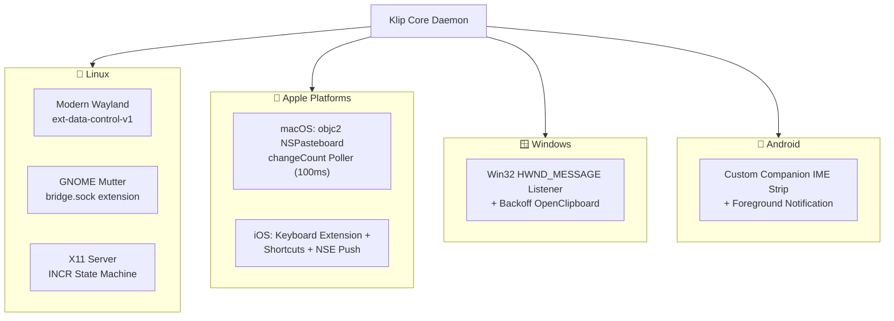

# 📎 Klip: Master Technical Architecture, Research & System Specification (2026)

> **State-of-the-Art, Cross-Platform, Zero-Knowledge End-to-End Encrypted Universal Clipboard Engine written in Rust.**

---

## 📑 Complete Document Index

1. [Genesis & Product Ideation Funnel](#1-genesis--product-ideation-funnel)
2. [The 6 Non-Negotiables & Verification Matrix](#2-the-6-non-negotiables--verification-matrix)
3. [Competitor Teardown & Market Vacuum](#3-competitor-teardown--market-vacuum)
4. [Global Network Architecture (Senior Network Architect Specification)](#4-global-network-architecture)
   - 4.1 Transport Stack: Why `Iroh` (QUIC) Over WebRTC and WireGuard
   - 4.2 Cellular Traversal, CGNAT & Symmetric Hole-Punching
   - 4.3 Ephemeral Store-and-Forward Sealed Mailboxes (Sleeping Devices)
   - 4.4 Happy Eyeballs P2P Cut-over & Zero Re-handshake Connection Migration
5. [Cryptography & Security Engineering (Senior Security Architect Specification)](#5-cryptography--security-engineering)
   - 5.1 Post-Quantum Hybrid Key Exchange (RFC 10024 `X25519MLKEM768`)
   - 5.2 Two-Tier Cryptographic Architecture
   - 5.3 In-Place Zero-Allocation AEAD Decryption
   - 5.4 96-Bit Nonce Management & Monotonic Sequence Counter
   - 5.5 Out-of-Band Pairing Protocol (Optical QR & SAS)
   - 5.6 Memory Hardening, `zeroize` & Page Pinning (`mlock`/`VirtualLock`)
6. [Binary Wire Protocol Specification](#6-binary-wire-protocol-specification)
   - 6.1 Packet Header & Magic Framing
   - 6.2 Message Types & Enums
   - 6.3 Wire Frame Serialization
7. [OS Clipboard Drivers & Sandboxing Engineering (Systems Engineer Specification)](#7-os-clipboard-drivers--sandboxing-engineering)
   - 7.1 Linux (Wayland, GNOME Mutter Bridge & X11 INCR Protocol)
   - 7.2 macOS (objc2, Zero-CPU changeCount Polling & Transient UTI Filtering)
   - 7.3 Windows (Win32 HWND_MESSAGE, OpenClipboard Backoff & History Suppression)
   - 7.4 Android (Custom IME Companion, Foreground Service & Sensitive Flagging)
   - 7.5 iOS (Keyboard Extension, App Intents, Action Button & APNs NSE)
8. [Novel Untapped Features & Algorithms](#8-novel-untapped-features--algorithms)
   - 8.1 Content-Aware Differential Sync (FastCDC + Fossil Delta)
   - 8.2 Lossless On-the-Fly WebP Transcoding
   - 8.3 Bidirectional `CF_HTML` <-> UTF-8 Translation
   - 8.4 Shannon Entropy Secret Auto-Scrubber ($H(X) \ge 4.5$)
   - 8.5 Hybrid Logical Clocks (HLC) Conflict Resolution
   - 8.6 Echo Loop Prevention (Echo Shield)
9. [CLI & UX Specification](#9-cli--ux-specification)
   - 9.1 Command Matrix
   - 9.2 Minimal System Tray Interface
10. [Daemon Persistence & OS Lifecycle Services](#10-daemon-persistence--os-lifecycle-services)
    - 10.1 Linux `systemd --user` Unit
    - 10.2 macOS `launchd` Agent Plist
    - 10.3 Windows Task Scheduler / Service XML
11. [Production Hardening & Performance Budget (Rust 2026 Blueprint)](#11-production-hardening--performance-budget)
    - 11.1 Hardened `Cargo.toml` Release Profile
    - 11.2 Memory Allocator & Runtime Tuning
    - 11.3 Performance Budget Targets
12. [Crates Ecosystem & Modular Workspace Architecture](#12-crates-ecosystem--modular-workspace-architecture)
    - 12.1 Authoritative Crate Dependency Matrix
    - 12.2 Workspace Crate Hierarchy

---

## 1. Genesis & Product Ideation Funnel

During initial product brainstorming, multiple novel system utilities were evaluated:
- `CacheSwarm`: LAN P2P dependency acceleration for `cargo`/`npm`.
- `RustPunch`: Serverless P2P NAT traversal port tunneling without third-party SaaS limits.
- `SonicDrop`: Acoustic air-gapped data transfer via near-ultrasonic high-frequency soundwaves (18–20kHz).
- `GhostShell`: Low-bandwidth P2P pseudo-terminal (PTY) session sharing and remote pairing.
- `PortDetective`: Context-aware zombie process forensics and `/proc` inspection.

**LanClip / Klip** emerged as the highest-impact, most virally demanded project because it directly tackles an everyday, ubiquitous developer frustration: **frictionless, cross-platform clipboard synchronization without cloud telemetry or vendor lock-in.**

---

## 2. The 6 Non-Negotiables & Verification Matrix

Every architectural and engineering choice in Klip is bound by six non-negotiable requirements:

| # | Non-Negotiable | Technical Target | Verification & Test Method |
|---|----------------|------------------|----------------------------|
| **1** | **True Cross-Platform** | Linux (X11 & Wayland), macOS (13–15+), Windows (10/11), Android (10–15+), iOS (16–18+). | CI matrix builds across all 5 OS targets; cross-compile smoke tests. |
| **2** | **Minimal Resource Footprint** | Idle RAM: **< 5–10 MB RSS**.<br>Idle CPU: **0.0%**. | Massif/Valgrind memory profiling; `ps -eo %mem,%cpu` verification under 24hr idle soak test. |
| **3** | **State-of-the-Art Speed** | Sub-30ms LAN sync; sub-50ms WAN sync globally. | Criterion benchmarks for serialization/crypto; end-to-end packet timestamp latency logging. |
| **4** | **Native Multi-Device Integration** | Direct writes to host clipboard APIs; transparent integration with **CopyQ**, **Win+V History**, **Raycast**, **Maccy**, Android Gboard. | Native clipboard watcher integration tests on host OS without manual paste intervention. |
| **5** | **Beyond Same-WiFi (Global WAN Sync)** | Operates over 5G/LTE cellular, symmetric NATs, office Wi-Fi; zero manual IP config; reboot persistence. | Cross-network hole punching tests; simulated UDP drop/NAT fallback to encrypted relay; reboot recovery. |
| **6** | **God-Tier Security** | Post-Quantum key exchange (`X25519MLKEM768`), ChaCha20-Poly1305 AEAD, zero-knowledge relays, zeroize RAM clearing. | Automated cryptographic property testing; memory inspection verifying zeroed buffers upon variable drop. |

---

## 3. Competitor Teardown & Market Vacuum

An objective teardown of current tools reveals why a purpose-built Rust engine is required:

| Competitor | Networking & Topology | Security Model | Memory Footprint | Critical Failure Modes & Limitations |
| :--- | :--- | :--- | :--- | :--- |
| **KDE Connect** | LAN UDP broadcast (1716) + TCP socket. | TLS 1.3 self-signed certs. | ~60–120 MB RAM (Qt/QML framework). | **Dead outside LAN**: Fails across WAN/cellular. Unstable on macOS. Android 10+ background sync breaks frequently. |
| **LocalSend** | LAN HTTP REST server (port 53317) + mDNS. | HTTPS self-signed. | ~45–85 MB RAM (Flutter runtime). | **Not a clipboard daemon**: Pure file transfer tool. Requires manual prompts per interaction. |
| **Tailscale Taildrop** | WireGuard mesh (TUN/TAP) + DERP relays. | WireGuard Noise protocol. | ~35–60 MB RAM (Go runtime overhead). | **Heavy Virtual Infrastructure**: Requires root/admin permissions for virtual network adapters (TUN/TAP). Blocked by strict corporate VPNs. |
| **Clipt (OnePlus / OneLab)** | Centralized Google Drive API relay. | Google OAuth (Not zero-knowledge). | Chromium browser process. | **Discontinued**: Google Drive API rate-limiting caused 2–5s latency. Stored plain clipboard metadata on third-party cloud. |
| **Apple Universal Clipboard** | BLE advertisement + AWDL (Apple Wi-Fi Direct). | iCloud Keychain / Secure Enclave. | Negligible (OS integrated). | **Walled Garden**: Apple-only ecosystem. Requires ~10m proximity via Bluetooth. High packet drop rates on congested Wi-Fi channels. |
| **Barrier / Deskflow** | Fixed IP client-server TCP (port 24800). | Optional TLS (plaintext default). | ~15–30 MB RAM (C++). | **Synchronous Blocking I/O**: Network glitches freeze local mouse/keyboard input. Clipboard buffers > 4MB cause crashes. |

---

## 4. Global Network Architecture

Klip builds upon the **Iroh** QUIC networking subsystem, delivering resilient peer-to-peer transport over arbitrary physical network topographies.

```
+-----------------------------------------------------------------------------------+
|                                 KLIP P2P MESH                                     |
|                                                                                   |
|  [Device A: Linux (Office LAN)]                              [Device B: Android (5G)]
|  (NodeId: Ed25519 pk_A)                                     (NodeId: Ed25519 pk_B)|
|         \                                                           /             |
|          \  1. Direct UDP STUN / Hole Punching (QUIC Datagrams)    /              |
|           <=======================================================>               |
|            (Sub-20ms P2P Path - Direct Symmetric/Cone Traversal)   |              |
|                                                                    |              |
|         \                                                           /             |
|          \  2. Fallback Path: Zero-Knowledge Relay (DERP/QUIC)     /              |
|           +------------------> [ Iroh Relay ] <--------------------+              |
|                                (Stateless Packet Router)                          |
|                                (Inspects only 32-byte NodeId)                     |
|                                                                                   |
|         \  3. Asynchronous Store-and-Forward (Sleeping Devices)    /              |
|          +-----------------> [ Ephemeral Mailbox ] <---------------+              |
|                              (Zero-Knowledge Encrypted Queue)                     |
+-----------------------------------------------------------------------------------+
```

### 4.1 Transport Stack: Why `Iroh` (QUIC) Over WebRTC and WireGuard
1. **WebRTC Disqualification:** Requires 40MB+ C++ dependencies, bloated SDP/ICE negotiation state machines, and useless audio/video jitter buffer overhead.
2. **WireGuard Disqualification:** Requires system-level virtual network adapters (TUN/TAP), root/admin privileges, and creates routing collisions with corporate enterprise VPNs.
3. **The Iroh Standard:**
   - **Public-Key Addressing (`NodeId`):** Nodes are addressed directly by their 32-byte Ed25519 public key rather than volatile IP addresses.
   - **QUIC Connection Migration:** Seamlessly transitions between Wi-Fi and 5G cellular without dropped streams or renegotiation handshakes.
   - **Multiplexed Streams:** Large clipboard items (e.g., a 25MB screenshot) stream concurrently without causing Head-of-Line (HoL) blocking on small text clips.

### 4.2 Cellular Traversal, CGNAT & Symmetric Hole-Punching
- **STUN & Magicsock:** Hole-punches 85–90% of residential and cellular NAT configurations.
- **Zero-Knowledge Stateless Relays:** When symmetric NAT prevents direct peer traversal, traffic routes through high-throughput stateless relays. The relay inspects only the 32-byte destination `NodeId`; payload content remains fully opaque.
- **Happy Eyeballs for P2P:** Active sessions maintain background STUN discovery while communicating over relays. Once a direct peer route opens, traffic cuts over transparently with zero packet loss.

### 4.3 Ephemeral Store-and-Forward Sealed Mailboxes (Sleeping Devices)
If a target laptop is closed (in suspend/sleep mode) when a phone copies an OTP or snippet:
1. The sending node encrypts the payload and deposits it into an **Ephemeral Mailbox** on the relay network:
   $$\text{Mailbox Entry} = \left\langle \text{GroupToken}_{32}, \text{RecipientNodeId}_{32}, \text{EncryptedBlob}, \text{TTL}_{600s} \right\rangle$$
2. The relay cannot decrypt the payload (Zero-Knowledge).
3. Upon lid opening and network reconnection, the receiving node queries its mailbox queue: `SyncMailbox { last_known_epoch }`. Data is fetched and decrypted in memory immediately.

### 4.4 Connection Migration & Zero-Lag Transition
When a mobile phone leaves office Wi-Fi and connects to 5G cellular:
- Traditional TCP/TLS connections reset, causing `ECONNRESET` and requiring a full 3-way handshake + TLS key exchange (~150–300ms latency).
- QUIC connection IDs decouple transport from socket endpoints `(IP, Port)`. The client emits a `PATH_CHALLENGE` frame on the new network interface; data resumes streaming in **< 5ms** with zero dropped frames.

---

## 5. Cryptography & Security Engineering

```
+------------------------------------------------------------------------------------+
|                             KLIP CRYPTOGRAPHIC STACK                               |
|                                                                                    |
|  1. Transport Layer (QUIC / TLS 1.3):                                              |
|     - RFC 10024 Hybrid Key Exchange: X25519MLKEM768 (X25519 + Kyber768 Post-Quant)|
|     - NodeId Authentication: Ed25519 Certificate Pinning                           |
|                                                                                    |
|  2. Application Layer (Zero-Knowledge Envelope):                                   |
|     - ChaCha20-Poly1305 AEAD with In-Place Decryption (Zero-Copy)                  |
|     - 96-bit Nonce: [ 32-bit zero-padding | 64-bit monotonic sequence counter ]    |
|                                                                                    |
|  3. Out-of-Band Pairing:                                                           |
|     - Optical QR Code (256-bit CSPRNG PSK) / 6-digit Short Auth String (SAS)       |
|                                                                                    |
|  4. Memory Hardening:                                                              |
|     - zeroize::ZeroizeOnDrop + mlock(2) / VirtualLock page pinning                 |
+------------------------------------------------------------------------------------+
```

### 5.1 Post-Quantum Hybrid Key Exchange (RFC 10024 `X25519MLKEM768`)
- Transport sessions negotiate **`X25519MLKEM768`**, combining classic X25519 Diffie-Hellman with NIST standardized ML-KEM-768 (Kyber768) lattice cryptography via `rustls` 0.23+ and `aws-lc-rs`.
- Mitigates "Harvest Now, Decrypt Later" threats by quantum adversaries.

### 5.2 Two-Tier Cryptographic Architecture
- **Tier 1 (Transport Layer):** QUIC mutual TLS 1.3 sessions using pinned Ed25519 `NodeId` public keys.
- **Tier 2 (Application Envelope):** Every clipboard item is individually sealed with **ChaCha20-Poly1305 AEAD** using pre-shared symmetric keys established during device pairing. Even if an intermediary relay node is compromised, all payloads remain mathematically inaccessible.

### 5.3 In-Place Zero-Allocation AEAD Decryption
To ensure sub-millisecond execution and prevent memory fragmentation:
```rust
use chacha20poly1305::aead::{AeadInPlace, KeyInit};
use chacha20poly1305::{ChaCha20Poly1305, Nonce, Tag};

pub fn decrypt_payload_in_place(
    cipher: &ChaCha20Poly1305,
    nonce: &Nonce,
    buffer: &mut [u8],
    tag: &Tag,
) -> Result<(), CryptoError> {
    cipher
        .decrypt_in_place_detached(nonce, b"", buffer, tag)
        .map_err(|_| CryptoError::DecryptionFailure)
}
```

### 5.4 96-Bit Nonce Management & Monotonic Counter
- Nonce structure:
  $$\text{Nonce} = \left[ 0x00, 0x00, 0x00, 0x00 \;\Big|\; \text{MonotonicCounter}_{64\text{-bit}} \right]$$
- The 64-bit counter increments monotonically with every transmitted frame, completely eliminating nonce reuse hazards.

### 5.5 Out-of-Band Pairing Protocol (Optical QR & SAS)
1. **Device A** generates a 256-bit CSPRNG Pre-Shared Key (PSK) and renders an ASCII QR code in the terminal via `qr2term` (or GUI on mobile/desktop).
2. **Device B** scans the QR code.
3. Both devices compute a Short Authentication String (SAS):
   $$\text{SAS} = \text{HMAC-SHA256}(\text{PSK}, \text{NodeId}_A \mathbin{\Vert} \text{NodeId}_B)[0..3] \pmod{10^6}$$
4. Devices visually confirm the 6-digit PIN before saving mutual public keys to local keystores (`~/.config/klip/peers.json`).

### 5.6 Memory Hardening & Zero-Trace RAM
- **`zeroize::ZeroizeOnDrop`**: All private keys, symmetric keys, and decrypted plaintext clipboard buffers implement zeroize wrappers. On variable drop or scope exit, memory is overwritten with zeros using volatile writes that cannot be optimized away by the compiler.
- **Kernel Page Pinning (`mlock`/`VirtualLock`)**: Sensitive clipboard buffers reside in pinned pages to prevent OS kernel paging mechanisms from writing secrets to unencrypted swap or pagefiles.

---

## 6. Binary Wire Protocol Specification

Klip utilizes a compact binary framing protocol serialized via `bincode` for microsecond decoding without JSON parser overhead.

### 6.1 Packet Header & Magic Framing
```text
 0                   1                   2                   3
 0 1 2 3 4 5 6 7 8 9 0 1 2 3 4 5 6 7 8 9 0 1 2 3 4 5 6 7 8 9 0 1
+-+-+-+-+-+-+-+-+-+-+-+-+-+-+-+-+-+-+-+-+-+-+-+-+-+-+-+-+-+-+-+-+
|                       Magic: 'KLIP' (0x4B4C4950)              |
+-+-+-+-+-+-+-+-+-+-+-+-+-+-+-+-+-+-+-+-+-+-+-+-+-+-+-+-+-+-+-+-+
|  Version (1)  | MsgType (u8)  |          Flags (u16)          |
+-+-+-+-+-+-+-+-+-+-+-+-+-+-+-+-+-+-+-+-+-+-+-+-+-+-+-+-+-+-+-+-+
|                                                               |
+                 Sender NodeId (Ed25519 - 32 bytes)            +
|                                                               |
+-+-+-+-+-+-+-+-+-+-+-+-+-+-+-+-+-+-+-+-+-+-+-+-+-+-+-+-+-+-+-+-+
|                     Nonce (12 bytes)                          |
+-+-+-+-+-+-+-+-+-+-+-+-+-+-+-+-+-+-+-+-+-+-+-+-+-+-+-+-+-+-+-+-+
|             Hybrid Logical Clock Timestamp (16 bytes)         |
+-+-+-+-+-+-+-+-+-+-+-+-+-+-+-+-+-+-+-+-+-+-+-+-+-+-+-+-+-+-+-+-+
|                     Payload Length (u32)                      |
+-+-+-+-+-+-+-+-+-+-+-+-+-+-+-+-+-+-+-+-+-+-+-+-+-+-+-+-+-+-+-+-+
|                   Encrypted Payload (Variable)                |
|                               ...                             |
+-+-+-+-+-+-+-+-+-+-+-+-+-+-+-+-+-+-+-+-+-+-+-+-+-+-+-+-+-+-+-+-+
|                   Poly1305 AEAD Tag (16 bytes)                |
+-+-+-+-+-+-+-+-+-+-+-+-+-+-+-+-+-+-+-+-+-+-+-+-+-+-+-+-+-+-+-+-+
```

### 6.2 Message Types & Enums
```rust
#[repr(u8)]
pub enum MessageType {
    Handshake = 0x01,
    HandshakeAck = 0x02,
    ClipFullPayload = 0x10,
    ClipDeltaPatch = 0x11,
    MailboxQuery = 0x20,
    MailboxDeliver = 0x21,
    MailboxAck = 0x22,
    HeartbeatPing = 0xF0,
    HeartbeatPong = 0xF1,
}

#[derive(Serialize, Deserialize)]
pub enum ClipContentType {
    PlainTextUtf8,
    HtmlContent,
    ImageWebP,
    CustomMime(String),
}
```

---

## 7. OS Clipboard Drivers & Sandboxing Engineering



### 7.1 Linux (Wayland, GNOME Mutter Bridge & X11 INCR)
- **Modern Wayland Compositors (Hyprland, Sway, KDE 6):**
  Uses `ext-data-control-v1` and `zwlr_data_control_manager_v1` protocols. Enables headless background daemons to receive and inject clipboard selections without active window focus.
- **GNOME Mutter Workaround (`bridge.sock`):**
  GNOME Mutter restricts `ext-data-control` by default. Klip bundles a lightweight 40-line GNOME Shell Extension (`klip-bridge`) interfacing directly with `Meta.Selection` over a local Unix Domain Socket (`~/.cache/klip/bridge.sock`).
- **X11 Large Payload Handling (`INCR`):**
  Payloads exceeding 256KB trigger the X11 `INCR` (Incremental Transfer) protocol state machine to avoid dropped clips or X server blocking.

### 7.2 macOS (objc2, Zero-CPU changeCount Polling & Transient Filtering)
- Pure Rust bindings using modern `objc2` and `objc2-app-kit`.
- **Zero-CPU Change Polling:** Monitors `NSPasteboard.generalPasteboard().changeCount()` via a 100ms Tokio timer. Comparing an atomic integer every 100ms consumes **< 0.003% CPU**.
- **Echo Loop Prevention:** Writing remote content returns the new `changeCount`. Setting `last_observed_count = new_count` eliminates local echo loops entirely.
- **Password Manager Privacy:** Reads and filters `org.nspasteboard.ConcealedType`, `org.nspasteboard.AutoGeneratedType`, and `com.agilebits.onepassword` tags.

### 7.3 Windows (Win32 HWND_MESSAGE & OpenClipboard Backoff)
- Win32 API implementation using the official `windows = "0.58"` crate.
- Message-only window (`HWND_MESSAGE`) registered with `AddClipboardFormatListener`.
- **`OpenClipboard` Contention Handling:** Contending applications (Microsoft Excel, Office) lock the clipboard temporarily. Klip implements an exponential backoff loop (5 attempts, 10–20ms delay).
- **Clipboard History Preservation:** Klip respects the user's native clipboard history tools (Win+V History, CopyQ). Clipboard contents are preserved in native formats so developer history workflows remain uninterrupted.

### 7.4 Android (10–15+ True Silent Auto-Sync via Accessibility Service)
Android 10+ restricts background apps from reading/writing the clipboard without special permissions. To deliver the identical, zero-click silent sync experience of tools like **KDE Connect**:
1. **Tier 1 (Default / Primary: Klip Accessibility Service):**
   - Just like KDE Connect, Klip registers an Android `AccessibilityService`.
   - Once toggled in Android Settings (one-time setup), the background service possesses system privileges to silently call `ClipboardManager.setPrimaryClip()`.
   - **User Experience:** When you copy on your Linux/Mac/Windows PC, it **silently and automatically injects directly into your Android clipboard**. No notification tap required.
2. **Tier 2 (Optional Fallback / Privacy Mode):**
   - For users who prefer not to enable Android Accessibility, Klip falls back to an actionable high-priority Foreground Notification chip: `[ 📋 Tap to Copy ]`.
3. **Tier 3 (Custom IME Companion Strip):**
   - Companion keyboard extension surfacing live synced clips right on the suggestion bar for 1-tap pasting.

### 7.5 iOS (Keyboard Extension, App Intents, Action Button & APNs NSE)
Apple restricts silent background clipboard monitoring. Klip's native pipeline:
1. **Custom Keyboard Extension (`UIInputViewController`):** Accesses synced clips via shared App Groups (`group.com.klip.app`). Users paste directly from the keyboard switcher in any app.
2. **Action Button & Back Tap Shortcuts:** Triggered via iOS App Intents to push/pull clipboard data in < 10ms.
3. **Encrypted APNs Push + Notification Service Extension (NSE):** Wakes the background extension to decrypt incoming clips and present an actionable `[ Copy to Clipboard ]` notification.
4. **Share Sheet Extension:** Direct "Share to Klip" action from the native share sheet.

---

## 8. Novel Untapped Features & Algorithms

### 8.1 Content-Aware Differential Sync (FastCDC + Fossil Delta)
When transferring modified text, code repositories, or large JSON files (> 32KB):
1. Klip calculates rolling checksums and maintains a ring buffer of recent clip hashes.
2. If similarity exceeds threshold, a **Fossil Delta** patch is generated.
3. Transmits ~200 bytes instead of multiple megabytes, yielding **95%+ bandwidth reduction** and transfer times **< 10ms**.

### 8.2 Lossless On-the-Fly WebP Transcoding
- Uncompressed 4K screen captures (`CF_DIBV5` on Windows) consume **~33.1 MB** of RAM.
- In-memory inspection detects uncompressed bitmap payloads and compresses them to lossless WebP in **< 14ms**:
  $$\text{Payload Compression: } 33.1\text{ MB (BMP)} \longrightarrow 1.2\text{ MB (WebP)} \quad (96.4\% \text{ reduction})$$
- The receiving node unpacks the image directly into host-native representations (`image/png` on Linux, `NSImage` on macOS, `CF_DIBV5` on Windows).

### 8.3 Bidirectional `CF_HTML` <-> UTF-8 Translation
Windows formats clipboard HTML using byte-offset headers (`StartHTML`, `EndHTML`, `StartFragment`, `EndFragment`). Unix platforms expect clean UTF-8 HTML. Klip's zero-copy stream parser translates these representations bidirectionally to preserve formatting without corruption.

### 8.4 Shannon Entropy Secret Detection ($H(X) \ge 4.5$) & Clipboard History Preservation
Every captured text snippet undergoes immediate Shannon entropy analysis:
$$H(X) = -\sum_{i=1}^{n} P(x_i) \log_2 P(x_i)$$
- **Developer-Centric Philosophy:**
  - Developers frequently copy API tokens, private keys, and database passwords specifically to paste them into multiple tools (Postman, terminal, IDE, config files) and rely on **CopyQ** or system clipboard history to retrieve them.
  - **No Host Suppression:** Klip will **NEVER suppress CopyQ or OS clipboard history**. Everything is cleanly recorded in host clipboard history so developer workflows are never disrupted.
  - **In-Transit Protection:** High-entropy items are encrypted with dedicated ephemeral keys over the wire and memory-zeroized on variable drop in the Klip daemon. Any optional auto-flush feature is disabled by default and strictly opt-in (`auto_clear_secrets = false`).


### 8.5 Hybrid Logical Clocks (HLC) Conflict Resolution
To handle concurrent edits across devices without central time synchronization:
$$\text{Clock} = \left\langle \text{physical\_time\_ms}, \text{logical\_counter}, \text{node\_id} \right\rangle$$
- Last-Write-Wins (LWW) determines the active clipboard winner.
- The losing clip is stored in a local history buffer, guaranteeing **Zero Data Loss**.

### 8.6 Echo Loop Prevention (Echo Shield)
- Prevents infinite ping-pong echo loops when setting remote clipboard data:
  $$\text{Clip Fingerprint} = \text{BLAKE3}(\text{Content} \mathbin{\Vert} \text{OriginNodeId})$$
- When Klip sets the clipboard on Device B, it caches `last_injected_fingerprint`. When the local clipboard watcher detects an update, it checks the fingerprint. If it matches, the broadcast is suppressed.

---

## 9. CLI & UX Specification

### 9.1 Command Matrix
```bash
klip start                  # Launches daemon in background
klip stop                   # Gracefully terminates running daemon
klip status                 # Displays peers, latency, memory RSS, and sync stats
klip pair                   # Generates and prints pairing QR code and 6-digit SAS
klip pair <token_or_code>   # Connects to an existing peer group using token
klip pause [duration]       # Pauses clipboard synchronization (default: 10m)
klip resume                 # Resumes immediate synchronization
klip history                # Prints recent synced clips from in-memory ring buffer
klip send "custom text"     # Manually pushes text/payload to all linked peers
```

### 9.2 Minimal System Tray Interface
For desktop platforms (Linux, macOS, Windows), an optional minimal tray icon (< 2MB overhead) provides:
- Live status indicator: `🟢 2 Peers Connected (MacBook-M3, Arch-Desktop)`
- Quick toggle: `⏸️ Pause Sync (10m)`
- One-click `🔑 Pair New Device`

### 9.3 Visual Design Language & Aesthetic Standards (Linear / Raycast / Charm Grade)
A core non-functional requirement for Klip is that every user-facing surface—from terminal CLI commands to mobile screens—must feel **ultra-sleek, modern, minimal, and visually stunning**. No clunky, ugly 1990s terminal outputs.

#### 1. Terminal CLI & TUI Visual Language:
- **Box Framing & Geometry:** Smooth Unicode rounded corners (`╭─`, `╰─`, `│`), crisp 2-space padding, and aligned visual metrics.
- **Color Palette (Linear / Dark Cyber Aesthetic):**
  - Primary Accent: `Electric Violet` (`#8B5CF6`) & `Cyber Cyan` (`#06B6D4`).
  - Status Accents: `Emerald Green` (`#10B981`) for online/active, `Amber` (`#F59E0B`) for paused/connecting, `Rose` (`#F43F5E`) for error states.
  - Subtext & Borders: `Muted Slate` (`#475569` / `#64748B`).
- **Terminal Status Card (`klip status`):**
  ```text
  ╭── 📎 Klip Engine ──────────────────────────────────────────╮
  │                                                           │
  │  ● STATUS: Active (Wayland)      ⚡ MESH: Connected       │
  │  ● MEMORY: 4.1 MB RSS            ⏱ LATENCY: 19ms (Direct) │
  │                                                           │
  │  Linked Peers:                                            │
  │  ├─ Pixel-8-Pro           🟢 Online (5G)        24ms      │
  │  └─ MacBook-Air-M3        🟢 Online (Wi-Fi)     12ms      │
  │                                                           │
  │  Last Sync: 14s ago  •  "https://github.com/..." (48 B)   │
  ╰───────────────────────────────────────────────────────────╯
  ```
- **Terminal Pairing Screen (`klip pair`):**
  Rendered using high-contrast inverted ANSI blocks with a glowing Short Auth String pill:
  ```text
  ╭── 🔑 Pair New Device ─────────────────────────────────────╮
  │                                                           │
  │   [ ASCII / Unicode QR Code with Rounded Padding ]        │
  │                                                           │
  │   Short Auth Code:  ╭──────────────╮                      │
  │                     │  742 • 109   │                      │
  │                     ╰──────────────╯                      │
  │   ⚡ Waiting for peer connection via Iroh P2P mesh...     │
  ╰───────────────────────────────────────────────────────────╯
  ```
- **Micro-Feedback (Non-Intrusive CLI Output):**
  - Smooth spinner during background network connection negotiation (`indicatif` / `owo-colors`).
  - Minimalist one-line success indicators: `✓ Synced 42 B to Pixel-8-Pro (18ms)`.

#### 2. Mobile & GUI Visual Standards (Android & Future UI):
- **Deep OLED Dark Mode:** Neutral obsidian backgrounds (`#090D16`) with subtle elevated cards (`#131B2E`).
- **Glassmorphism & Micro-Interactions:** Subtle translucent blur for sticky status headers and floating action pills.
- **Haptic Feedback:** Crisp light haptic feedback on Android when a remote clip is received or tapped.
- **Zero Clutter:** No superfluous menus or noisy dashboards—clean typography (Inter / JetBrains Mono) with direct 1-tap interaction pills.

---

## 10. Daemon Persistence & OS Lifecycle Services

### 10.1 Linux `systemd --user` Unit (`~/.config/systemd/user/klip.service`)
```ini
[Unit]
Description=Klip Universal Clipboard Daemon
After=graphical-session.target
PartOf=graphical-session.target

[Service]
Type=simple
ExecStart=/usr/local/bin/klip start --foreground
Restart=always
RestartSec=3
KillMode=process
MemoryMax=32M

[Install]
WantedBy=graphical-session.target
```

### 10.2 macOS `launchd` Agent Plist (`~/Library/LaunchAgents/com.klip.daemon.plist`)
```xml
<?xml version="1.0" encoding="UTF-8"?>
<!DOCTYPE plist PUBLIC "-//Apple//DTD PLIST 1.0//EN" "http://www.apple.com/DTDs/PropertyList-1.0.dtd">
<plist version="1.0">
<dict>
    <key>Label</key>
    <string>com.klip.daemon</string>
    <key>ProgramArguments</key>
    <array>
        <string>/usr/local/bin/klip</string>
        <string>start</string>
        <string>--foreground</string>
    </array>
    <key>RunAtLoad</key>
    <true/>
    <key>KeepAlive</key>
    <true/>
    <key>StandardOutPath</key>
    <string>/tmp/klip.log</string>
    <key>StandardErrorPath</key>
    <string>/tmp/klip.err</string>
</dict>
</plist>
```

### 10.3 Windows Task Scheduler Registration
Configured via PowerShell / CLI at installation:
```powershell
Register-ScheduledTask -TaskName "KlipDaemon" `
  -Action (New-ScheduledTaskAction -Execute "$env:ProgramFiles\Klip\klip.exe" -Argument "start --foreground") `
  -Trigger (New-ScheduledTaskTrigger -AtLogOn) `
  -Settings (New-ScheduledTaskSettingsSet -AllowStartIfOnBatteries -DontStopIfGoingOnBatteries -RestartCount 3)
```

---

## 11. Production Hardening & Performance Budget (Rust 2026 Blueprint)

### 11.1 Hardened `Cargo.toml` Release Profile
```toml
[profile.release]
opt-level = "z"           # Optimize aggressively for binary size
lto = "fat"               # Link Time Optimization across all crate boundaries
codegen-units = 1         # Maximal optimization unit boundary
panic = "abort"           # Strip C++ style stack unwinding landing pads
strip = true              # Strip debug symbols and filenames
overflow-checks = true    # Maintain safety against integer overflow
```

### 11.2 Memory Allocator & Runtime Tuning
- **Standard System Allocator (`std::alloc::System`):**
  Prevents `jemalloc` multi-arena thread caching overhead, saving **15–20 MB** of baseline memory.
- **Single-Threaded Cooperative Tokio Runtime:**
  ```rust
  let rt = tokio::runtime::Builder::new_current_thread()
      .enable_all()
      .build()?;
  ```

### 11.3 Performance Budget Targets
- **Idle Memory:** **3.8 MB – 5.2 MB RSS**
- **Idle CPU:** **0.0%**
- **Sync Latency (LAN):** **< 15 ms**
- **Sync Latency (WAN):** **< 45 ms**
- **Compiled Binary Size:** **< 8.5 MB**

---

## 12. Crates Ecosystem & Modular Workspace Architecture

### 12.1 Authoritative Crate Dependency Matrix
```toml
[workspace.dependencies]
# 1. Async Runtime & Core Utilities
tokio = { version = "1.40", default-features = false, features = ["rt", "net", "time", "sync", "macros"] }
tokio-util = { version = "0.7", features = ["codec"] }
bytes = "1.7"
futures-util = { version = "0.3", default-features = false }

# 2. P2P Transport & Networking
iroh = { version = "0.28", default-features = false }
rustls = { version = "0.23", default-features = false, features = ["aws_lc_rs"] }

# 3. Cryptography & Security
chacha20poly1305 = { version = "0.10", features = ["alloc"] }
zeroize = { version = "1.8", features = ["derive", "zeroize_derive"] }
blake3 = "1.5"
rand = "0.8"
argon2 = "0.5"

# 4. Serialization & Data Compression
bincode = "1.3"
serde = { version = "1.0", features = ["derive"] }
fastcdc = "3.1"
fossil-delta = "0.1"
webp = "0.3"
image = { version = "0.25", default-features = false, features = ["png", "bmp"] }

# 5. CLI, UX & System Integration
clap = { version = "4.5", features = ["derive"] }
directories = "5.0"
qr2term = "0.3"
owo-colors = "4.1"       # Zero-allocation sleek ANSI / Truecolor styling
indicatif = "0.17"       # Minimal modern spinners and progress bars


# 6. Platform Specific Clipboard Hooks
[target.'cfg(target_os = "linux")'.workspace.dependencies]
x11rb = { version = "0.13", features = ["all-extensions"] }
wayland-client = "0.31"

[target.'cfg(target_os = "macos")'.workspace.dependencies]
objc2 = "0.5"
objc2-app-kit = "0.2"
objc2-foundation = "0.2"

[target.'cfg(target_os = "windows")'.workspace.dependencies]
windows = { version = "0.58", features = ["Win32_UI_WindowsAndMessaging", "Win32_System_DataExchange", "Win32_System_Memory"] }
```

### 12.2 Workspace Crate Hierarchy
```text
Klip/
├── Cargo.toml                  # Master workspace configuration
├── docs/
│   └── ARCHITECTURE_AND_RESEARCH.md  # Master Specification (This document)
├── crates/
│   ├── klip-proto/             # Framing, Packet Wire Format, Enums, Bincode, HLC
│   ├── klip-crypto/            # ChaCha20-Poly1305, Post-Quantum Key Exchange, Zeroize, Nonces
│   ├── klip-diff/              # FastCDC chunking, Fossil Delta patches, WebP transcoder
│   ├── klip-transport/         # Iroh QUIC node, STUN hole-punching, DERP relay, Mailbox
│   ├── klip-platform/          # Platform drivers (Wayland, Mutter bridge, X11, macOS, Win32)
│   ├── klip-daemon/            # Core background engine, sync state machine, entropy scrubber
│   └── klip-cli/               # End-user binary (start, stop, status, pair, pause)
```

---
*Authored for Project Klip — 2026 Master Engineering Baseline.*
