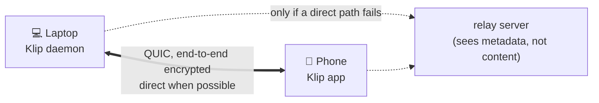

# Status, how it works, limits

> Part of the [Klip guide](guide/README.md). The honest list of what was tested and what was not.

## Status — what is actually tested

| Part | State | Evidence |
|---|---|---|
| Core engine (pairing, sync, conflict resolution) | ✅ working | 360 automated Rust tests (including the tray) in the whole workspace (real network endpoints, two full daemons, pairing, unpair, pause, bad input, random-input decoding) run in CI; a two-daemon crash/restart chaos script was run by hand (not in CI) |
| **Terminal app (TUI)** (`klip` with no arguments) | 🟡 Linux, tested in a pseudo-terminal and against two real daemons | The terminal app's own tests: screens as text snapshots at 60×16 and 100×30, 56,000 random key/mouse/paste/resize/reply events (no panic), the real binary in a pseudo-terminal (terminal restored after quit, SIGTERM, SIGHUP and a panic; `TERM=dumb`; resize), and a run with two real daemons (pair → send → copy back → pause → unpair all). Also run read-only against a real v0.3.6 daemon. **Not verified:** how it looks in kitty, gnome-terminal, alacritty, tmux or over SSH; macOS; Windows (not built: the CLI cannot reach the daemon there). |
| **Linux (X11)** daemon + CLI | ✅ tested on a real machine | pairing, clipboard in both directions through the real X11 clipboard, restart, unpair |
| **Tray app** (`klip tray`, Linux) | 🟡 tested without a real panel | Unit tests of every state and menu, and end-to-end tests of the real tray on a private D-Bus session against an isolated daemon (click through the menu, check what the daemon did, quit, a second tray refused). See the release notes for what was and was not seen on the author's real panel. |
| **Android app** | 🟡 emulator (Android 14) + one real phone (Vivo, reported by the author) | Emulator: pairing through the n0 relay, sync both ways, background clipboard write, restart/reconnect, reboot, notification, setup screens. Real phone (author's report): laptop → phone arrives by itself; phone → laptop works with Share → Klip, the notification button or the app's Send button. **Not verified:** background persistence over hours, reboot, camera QR scan, the tile, battery cost on a real phone |
| Linux Wayland | 🟡 partial | works through XWayland apps only; GNOME needs more work |
| macOS | 🟡 built and tested on a CI runner, never on a real Mac | On `macos-latest`: the whole workspace compiles, the tray's unit tests, the daemon end-to-end tests (31, with a real memory figure), the CLI against a real daemon (7), the login entry, and a 10-second start of the real tray without a crash. NOT seen: the menu bar icon and menu, real clicks, the real clipboard in a desktop session. |
| Windows | 🟡 built and tested on a CI runner, never on a real PC | The control channel is a named pipe (`\\.\pipe\klip-<hash>`) that only the user who runs the daemon can open (a DACL naming that user's SID). On `windows-latest`: it compiles, a daemon is started, answers on the pipe, takes a text and shows it in the history; the CLI against a real daemon (7), the core and daemon unit tests, the registry login entry, and a 10-second start of the real tray without a crash. NOT seen: the tray icon and menu, real clicks, the real clipboard, another user being refused by the pipe. |
| iOS | ⚪ not started | Apple does not allow background clipboard access |

## How it works



- Every device has an Ed25519 key; its public half is the device ID (`klip status` shows a short fingerprint like `VCUU-LBYY-ES2H`).
- Connections use QUIC/TLS 1.3 via [iroh](https://iroh.computer), which authenticates **both** sides by device key and tries to connect directly (hole punching); relays are the fallback.
- Only devices you paired are accepted. A clip is accepted only if the sender is the device that claims to have copied it.
- Conflicts: the newest copy wins (hybrid logical clock); clocks too far in the future are rejected.

## Limits & honesty

**Security — what you can and cannot expect**

- Clip contents are end-to-end encrypted between your devices. Relays and network observers see **metadata** (that two device IDs talk, when, and how much), never contents.
- With `"relay": "n0"`, your device ID and its network addresses are published to n0's discovery service so peers can find you. Use `"relay": "lan"` if that matters to you.
- Keys are classical (X25519 + Ed25519). **Post-quantum key exchange is not enabled yet** (planned; the library supports it as an option).
- Not independently audited. Do not rely on it for anything where a bug would be dangerous.
- The “secret” detector (patterns + entropy) is a heuristic: it hides previews in history and asks Android to hide keyboard previews. It does **not** stop secrets from syncing and will miss some.
- The keystore (`~/.config/klip/keystore.json`) holds the device key in a private (0600) file; it is not encrypted with a password or the OS keyring yet.
- Anyone who can run commands as you can read your clipboard history through the local control socket. A stolen or lost device stays trusted until you `klip unpair` it from another one.

**Behaviour**

- **Both devices must be online at the same time.** There is no mailbox or push service: a clip copied while the other device is off is not delivered later. (A deliberate choice: no server of ours.)
- **Images (v0.5.0, manual since v0.6.0):** a PNG/WebP copied on the computer waits until you send it (tray menu, middle click, `klip share`, or switch on automatic sending); then it lands on the phone's clipboard and pastes into other apps. From the phone, **Share → Klip** an image, or copy an image and tap the tile or the notification button; anything that is not PNG/WebP (JPEG, HEIC...) is converted to PNG first, which also removes EXIF/GPS data, applies the photo's rotation, and scales it down if it would be over the limit. Never automatic from the phone (Android does not let Klip read the clipboard in the background). Limits: 12 MB on the phone (32 MiB on a computer), at most 36 megapixels (about 8K); a bigger image, a file that is not really a PNG/WebP, or a "decompression bomb" is refused before it is decoded, and the sender is told. Received images are kept as files in the app's cache; old ones are removed when the next image arrives or when Klip restarts (the newest 4 are kept, none older than an hour at that moment), so the last received image can stay there longer. Animated GIFs and several images at once are not supported. Tested on the author's phone: a screenshot copied on the Linux computer arrives on the phone and pastes into WhatsApp.
- Clips are limited to 32 MiB by default (12 MB on the phone). **Android is stricter for text: a text clip over about 0.9 MB cannot be put on the phone's clipboard** (Android passes it through one Binder transaction of about 1 MB). The sender is told "the other device could not write its clipboard"; nothing crashes (it did before 0.3.6: see the [release notes](https://github.com/Tribal-Chief-001/Klip/releases/tag/v0.3.6-alpha)).
- **What is preserved.** Text is sent as UTF-8 bytes and written back unchanged: tabs, indentation, trailing spaces, blank lines, CRLF and bare CR, emoji, CJK, right-to-left text, combining and zero-width characters, a BOM, links with query strings, and very long lines. Tested between two desktop daemons with a 400 KB+ source-like file (byte for byte), and on an Android 14 emulator with 57 KB, 249 KB and 504 KB code files (accepted; a 504 KB clip made the round trip phone → laptop with the same size and the same start; no full byte-for-byte comparison on Android).
- **What is not.** Only *plain text* is synced between phone and computer: rich formatting (bold, colours, syntax highlighting copied from a web page or an editor), HTML tables are not carried over a phone (images are, see above; files go with `klip send-file`, computer to computer only for now). A copy that an app marks as sensitive (password managers) is not sent automatically by the optional helper.
- Large text from the terminal: `cat main.rs | klip send -` is limited by the daemon's clip limit (32 MiB by default) plus 64 KiB; text over the limit is refused before it is sent, with the limit in the message. (The argument form is limited to about 128 KB by Linux.)
- Idle cost (measured on a release build, one linked device, Linux/X11): about **14 MB** resident memory, ~**3 wakeups per second**, no measurable CPU. Capture is event-driven (the X server tells Klip when the clipboard changes); the remaining wakeups are iroh's connection upkeep. Without X11 events (headless / `KLIP_CLIPBOARD=memory`) Klip falls back to polling and uses more.
- Release binary: 8.2 MB (stripped, size-optimised; 7.8 MB before the terminal app). The terminal app idles at about 8 MB resident and 0.125 % of one core (measured over 120 s on a release build).
- Debug-signed Android builds change signature between CI runs; installing a newer build over an older one may require uninstalling first (re-pair afterwards). A stable release key is planned.

## Start automatically: what was verified

| Platform | Status |
|---|---|
| **Linux** | `klip install-service` + `systemctl --user enable --now klip.service` starts it at every login (systemd user unit). Verified: after `kill -9` systemd restarts the daemon in about 3 s and the phone reconnects. A full reboot of the author's machine has not been exercised. |
| **Android** | A foreground service (type *specialUse*, so Android 15's 6-hour limit and boot restrictions for *dataSync* do not apply) restarts after a reboot and reconnects by itself. Verified on an Android 14 emulator: after killing the app process Android restarted the service within 5 s and the laptop saw the device again; after a full emulator reboot, without opening the app, the service came back and the laptop could deliver a clip to it. After a reboot Android only delivers the boot event after the first unlock. **Not verified:** swiping the app out of recents, Android 15/16, and real phones' battery managers (Xiaomi, Oppo, Vivo, Samsung… may kill background apps: allow background activity / auto-start for Klip in the phone's settings). If you force-stop Klip, open it once to start it again (Android's rule). **Stop and restart rules (Android 14 emulator):** the *Stop* button in Android's active-apps list removes the whole app; a watchdog job (every ~15 min, switchable in Privacy) then starts Klip again, but only if Unrestricted battery use is allowed for it (without it Android refuses: tested both ways). The service also starts by itself after an app update and after a restart. A *Force stop* in App info cannot be undone by any app. If notifications are switched off and on again, the notification comes back within seconds (this was a bug before 0.3.4). |
| **macOS** | `klip install-service` writes a launchd agent for the daemon — never run, untested. `klip tray install` writes the tray's own launch agent (checked by a CI test that reads the file, not run by a real login). |
| **Windows** | `klip install-service` writes a Task Scheduler script — never run. The CLI, the terminal app and the tray do control the daemon now (named pipe). `klip tray install` writes the Run-key value (checked on a CI runner). |

```bash
klip install-service
systemctl --user enable --now klip.service
systemctl --user status klip.service
```

## Android app size

**Size.** The APK was 39 MB (three CPU types in one file, no code shrinking). It is now one APK per CPU type with the Kotlin code shrunk by R8 and without AppCompat/Material: **10.7 MB for arm64** (measured on a local release build). 95% of that is the Rust engine (QUIC, TLS, relay client), about 10 MB; a 2-3 MB app is not possible with this stack. The Android library is built with `panic = "abort"` (saves 2.2 MB); a crash restarts the background service by itself.
